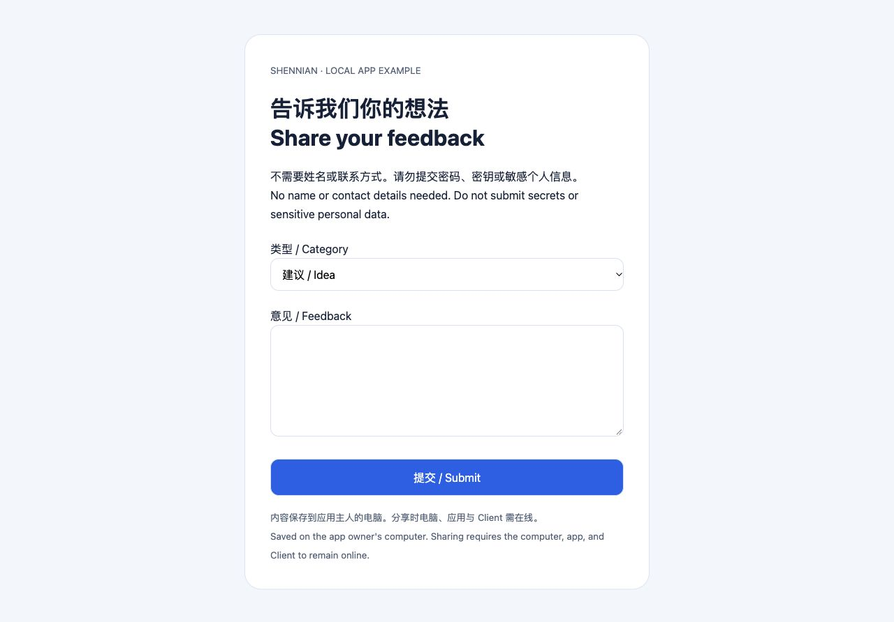
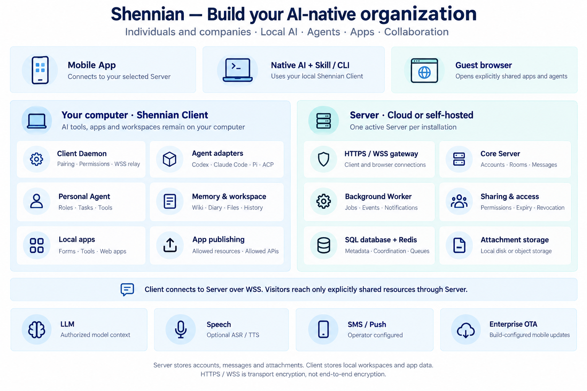

<div align="center">

# Shennian · 神念

### Build your AI-native organization

**Connect local AI · Build agents and apps · Share with others · Work together**

[简体中文](README.md) · [Website](https://shennian.net/en/) · [User guides](https://shennian.net/en/docs) · [Self-hosting](open-source/deploy/self-hosted/README.md) · [Contact](https://shennian.net/#contact)

[](https://github.com/CosmosShadow/shennian/actions/workflows/ci.yml)

</div>

> Private preparation repository. Publication awaits privacy remediation, history review, and explicit maintainer approval.

Shennian is AI-native collaboration software for **individuals and companies**. Connect the AI you already use and organize people, agents, and apps into one workflow. Build a personal AI team, or bring colleagues and AI with different roles together to discuss, assign, execute, and deliver work.

**You do not need to host a Server first.** Use Shennian Cloud or your own Server with the same App and Client. AI tools, workspaces, and local apps can run on your own computer; use your phone to participate, manage, and direct work.

## What you can build

| Capability | How it works |
|---|---|
| **Connect existing AI** | Client, CLI, and Skill connect tools such as Codex, Claude Code, Pi, and ACP agents. Keep your own models and tools. |
| **Build and share agents** | Set roles, computers, and working directories. Share an agent with friends, colleagues, or users, or add it to a room. |
| **Build and share apps** | Use AI to build feedback forms, websites, and business tools. Run them locally and expose only explicitly allowed resources and APIs. |
| **Collaborate with people and AI** | Rooms, invitations, messages, attachments, independent agent identities, and access controls connect discussion with delivery. |
| **Use your computer from your phone** | Manage paired computers, projects, conversations, and tasks; give instructions and review results. |
| **Personal assistance and memory** | Primary-computer and main-agent settings, Personal Agent, wiki/memory, diary, and background tasks; see the feature guide for supported scope. |
| **Self-host and operate** | Multi-user accounts, Server/Worker, SQL, Redis, attachments, formal migrations, backups, and upgrades. |
| **Configure optional services** | Bring your own model, speech, SMS, push, and enterprise OTA settings. Official credentials, signing keys, and update privileges are not included. |

[Full feature guide and version boundaries →](open-source/docs/features.md)

## Three ways to start

### 1. Turn existing AI into a shareable agent

Give AI a role such as product support, internal knowledge assistance, or project work. Create a share link or add it to a room. The owner controls access, expiry, and revocation. **Sharing one agent does not mean publishing an entire computer.**

### 2. Build a feedback form and let others fill it in

> “Build a feedback app with category and message fields, without names or contact details. Store submissions on my computer. Expose only the form and submission API, never data files or administration routes.”

The repository includes a **runnable, dependency-free bilingual feedback form**: [source and sharing instructions](open-source/docs/examples/feedback-form/README.md). Visitors submit through the share page, and the app writes to its own local data directory. This is not cloud hosting of your whole application. The computer, app, and Client must stay online.



### 3. Run your own support agent and AI team

The official website’s Shennian support agent demonstrates role-based agents, visitor conversations, and room collaboration. Configure your own product knowledge, model, and permissions to build support, internal assistants, or team agents on your own instance. **Self-hosting does not include the official support identity, private knowledge base, credentials, or operational data.**

[Application, support, and agent playbook →](open-source/docs/application-examples.md)

## Sign-in preview

Screenshots containing real accounts or workspaces have been withheld. Replacement demos will use synthetic data.


## Architecture and data boundaries



The mobile App connects to the selected Server. Native AI uses Client through Skill/CLI. Client connects to the same instance over WSS. Visitors use only explicitly shared apps and agents through the sharing gateway. The map shows module responsibilities, not a promise that every optional service is enabled. See the [architecture guide](open-source/docs/system-architecture.md) for exact runtime relationships.

- **Your computer:** workspaces, AI history, apps and their local business data, memory, and diary. Back up each computer separately.
- **Selected Server:** accounts, membership, messages, attachments, relay coordination, and task state. Choose Shennian Cloud or your own infrastructure.
- **Model provider:** receives the authorized context required for execution. HTTPS/WSS encrypts transport; it is **not end-to-end encryption**.
- One installation uses one active Server. Do not mix cloud and company accounts, tokens, or histories. Use the documented separate-installation procedure rather than overwriting an existing binding.
- App sharing allows specific resources and APIs, with expiry and revocation. Do not publish secrets, data files, administration endpoints, or arbitrary ports.

## Installation and deployment: choose your path

| What you want | Overview | Detailed guide |
|---|---|---|
| **Use Shennian Cloud** | Install the mobile App and computer Client, confirm your account, pair, and connect your AI. No self-hosted Server is required to build and share apps. | [Install and first use](open-source/docs/getting-started.en.md#1-use-shennian-cloud) |
| **Build from source** | Prepare Node.js/pnpm, clone and install frozen dependencies, build App/Client, and configure the native platform tools. | [Source build guide](open-source/docs/getting-started.en.md#2-build-from-source) |
| **Host your own Server** | Prepare infrastructure and an HTTPS domain, initialize independent configuration, start Docker, and connect App/Client to the same instance. | [Self-hosting walkthrough](open-source/docs/getting-started.en.md#3-self-host-your-server) |

Start with one model and verify pairing and a real reply before enabling speech, SMS, push, or your own OTA service. Third-party AI accounts, fees, and quotas follow their providers' rules. Never reinitialize an existing instance or delete its data volumes.

**Guides:** [First use and troubleshooting](open-source/docs/getting-started.en.md) · [Mobile builds and signing](open-source/docs/mobile-app.md) · [Backup, restore, and upgrades](open-source/deploy/self-hosted/backup-and-upgrade.md) · [Enterprise OTA](open-source/docs/enterprise-ota.md) · [Feedback form example](open-source/docs/examples/feedback-form/README.md)

## Source map

```text
packages/app/                Shared mobile App
open-source/packages/        Server, Worker, Client/CLI, Wire, SDK
open-source/docs/            Features, architecture, usage, security
open-source/docs/examples/   Runnable application examples
open-source/deploy/          Docker, migrations, backups, updates
plugins/shennian/            Skill and integration material
```

SSO is not included in this release. Optional functionality depends on platform, release, and instance configuration. See the [feature guide](open-source/docs/features.md) and [acceptance matrix](open-source/docs/self-hosted-acceptance.md) for detailed scope.

## License and contact

Personal use and internal use by one organization with up to **20 enabled human accounts** are free within the license terms, retaining branding and copyright notices. Modification and builds are allowed within those terms. For higher usage, debranding, hosting, or resale, [contact the team via website WeCom](https://shennian.net/#contact). No activation lock or public price is included.

This project uses the [Shennian Community License 1.0](LICENSE), a restricted source-available license, **not MIT/Apache or unrestricted commercial permission**. Third-party components retain their own licenses. Rights to independently created apps, content, and business data do not transfer to the project. [License details](open-source/LICENSE-STATUS.md) · [Third-party notices](open-source/docs/third-party/README.md)
