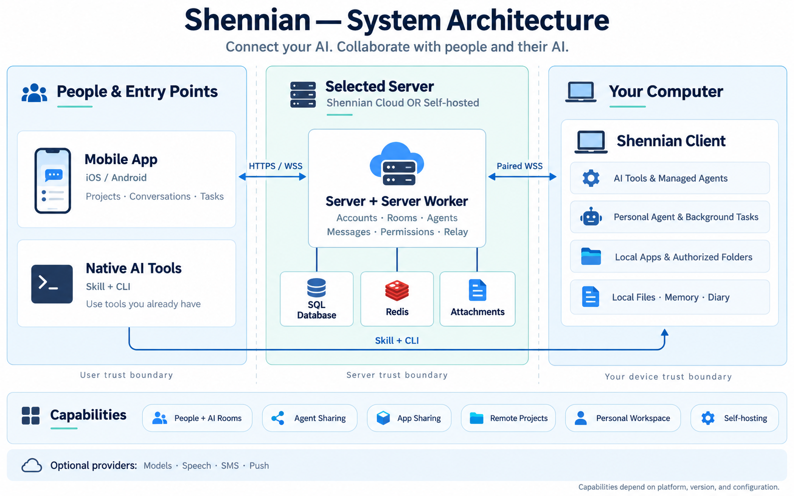
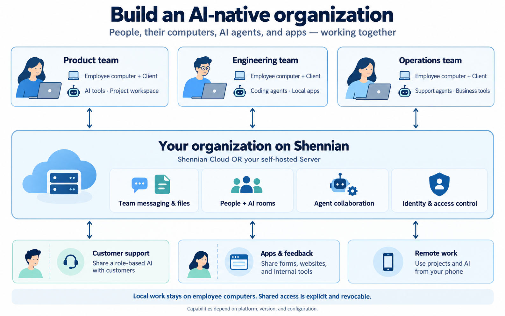

# Shennian

**Connect your AI. Collaborate with people and their AI.**

[简体中文](README.md) · [Website](https://shennian.net/en/) · [Install Client & Skill](https://shennian.net/install.md) · [All user guides](https://shennian.net/en/docs) · [All features](open-source/docs/features.md)

> Private preparation repository. The repository is not publicly accessible yet; publication requires a separate maintainer decision.

Shennian connects the AI tools on your computer with people, agents, and local applications. Use the mobile App or an existing AI tool to direct work, collaborate in rooms, and share selected agents or applications. Choose Shennian Cloud or an independent self-hosted Server.

## System architecture

| Component | Responsibility |
|---|---|
| **Mobile App** | iOS and Android entry point for computers, projects, conversations, and tasks. |
| **Selected Server** | Accounts, rooms, messages, permissions, relay coordination, and server-side background processing. Choose Shennian Cloud or self-hosting per installation. |
| **Shennian Client** | Runs on your computer, pairs with the selected Server, and connects local AI tools, managed agents, and authorized applications. |
| **Local workspace** | Keeps local files, app business data, memory, diary, and native AI history on the owning computer. |
| **Optional providers** | Supply models, speech, SMS, and push when configured. Model providers receive the authorized context needed to execute a request. |

Native AI tools use Skill and CLI to reach Client. The App and Client connect to the same Server over HTTPS/WSS. Transport encryption is not end-to-end encryption. The diagram summarizes responsibilities; [architecture contracts and data boundaries](open-source/docs/system-architecture.md) define exact behavior.

## Features

| Capability | What you can use it for | Availability |
|---|---|---|
| **Connect existing AI** | Client, CLI, and Skill connect local AI, tools, and sessions. | Available |
| **People and AI in rooms** | Members, invitations, messages, attachments, permissions, and in-app unread state. | Available |
| **Agents and sharing** | Agent identities, conversations, sharing links, discovery, and contacts. | Available |
| **Machine sharing and revocation** | Give trusted people machine-level access to AI; owners manage invitations and revocation. | Available |
| **Mobile remote control** | Manage computers, projects, AI, and task conversations from a phone. | Available depending on platform and version |
| **Personal Agent and main-agent settings** | Choose a primary computer, configure models and default worker AI, and let the built-in assistant use authorized capabilities. | In staged development |
| **Wiki, memory, and diary** | Markdown on the primary computer, bounded index access, diary replicas, and edit-conflict controls. | Development candidate |
| **Background workers and tasks** | Authorized background execution, task state, events, and results; high-impact actions still need confirmation. | Depends on execution path and version |
| **Reminders, calendar, notes, and listening** | Personal records, reminders, recording, and transcription are delivered by module and version. | In staged development |
| **Project coordination** | Project queues, coordinator conversations, worker orchestration, and the Client local page. | Preview; not guaranteed in stable |
| **Local folders and apps** | Browse authorized folders and access registered apps and local services, not arbitrary paths or ports. | Development candidate |
| **Share local and self-developed apps** | Share apps you develop or register, with explicit resource and API permissions, expiry, and revocation. | Server available; publishing depends on Client version |
| **Self-hosted deployment and accounts** | Independent Server, Worker, database, Redis, local attachments, and local accounts; choose cloud or self-hosted per installation. | Core flow verified |
| **Backup, restore, and upgrades** | Cover the database, attachments, configuration, Redis, and the isolated Client used in this test. | Single-instance drill passed |
| **Models, speech, and notifications** | Operators configure models, ASR/TTS, SMS, and push as needed; secrets are not sent to ordinary clients. | Optional configuration |
| **Enterprise-owned OTA** | Enterprise builds can disable OTA or pin their own HTTPS update source and signing certificate; business-server selection does not change code trust. | Configuration, signing tools, and enterprise distribution service are development candidates |
| **Enterprise SSO** | Use local accounts and registration policies for now. | Deferred, outside the current delivery |

Availability depends on the platform, installed version, and deployment configuration. A feature appearing in the architecture does not mean every self-hosted combination has been verified. See the [complete feature guide](open-source/docs/features.md) and [self-hosted acceptance matrix](open-source/docs/self-hosted-acceptance.md).

## People and AI working together

Employees connect their AI from their own computers. The selected organization Server manages accounts, rooms, and permissions. People and role-based agents discuss work, assign tasks, and review results; customers can use explicitly shared support agents, forms, and business tools. This is a conceptual collaboration map; feature status and acceptance scope are listed above.

## Get started with Shennian Cloud

No self-hosted Server is required.

1. **Get the mobile App.** Choose [iOS or Android on the website](https://shennian.net/en/#downloads), then select **Shennian Cloud** and sign in or create your account.
2. **Install Client and Skill on your computer.** Follow the [official installation guide](https://shennian.net/install.md). If you already use a local AI tool, give it the instruction below. Reuse an existing Client; approve pairing yourself.
3. **Connect your AI.** Connect an already installed and signed-in tool, pair the computer with the same account, and verify one real reply. [AI setup guide](https://shennian.net/en/docs#ai-setup).
4. **Start using it.** Open the paired computer or a project from your phone, start a conversation, and review the result. Create a room to work with people and AI, or share a selected agent. [Quick start](https://shennian.net/en/docs#quick-start) · [Rooms](https://shennian.net/en/docs#collaboration) · [Sharing](https://shennian.net/en/docs#sharing).

> Read https://shennian.net/install.md and help me install or reuse Shennian Client and Skill on this computer. Guide me through pairing with Shennian Cloud, check my selected AI tool, and verify one real reply. Ask me to approve pairing myself; do not ask me to paste passwords, verification codes, tokens, or API keys into chat.

Using someone else's shared AI or joining a room does not require connecting your own AI first. Running your own AI remotely requires a working computer Client and a compatible AI tool. Third-party accounts, costs, and quotas remain subject to their providers.

## Build or self-host

| Path | Main steps | Guide |
|---|---|---|
| **Build from source** | Request repository access while private; prepare Node.js and pnpm, clone, install frozen dependencies, and build App and Client. Native distribution uses your signing configuration. | [Source build](open-source/docs/getting-started.en.md#2-build-from-source) · [Mobile builds](open-source/docs/mobile-app.md) |
| **Self-host a Server** | Prepare infrastructure and trusted HTTPS, initialize independent instance configuration, start Docker Compose, and connect App and Client to that same instance. | [Self-hosting walkthrough](open-source/docs/getting-started.en.md#3-self-host-your-server) · [Docker deployment](open-source/deploy/self-hosted/README.md) |
| **Operate your instance** | Back up database, attachments, configuration, and each Client; follow migration and rollback procedures when upgrading. | [Backup and upgrade](open-source/deploy/self-hosted/backup-and-upgrade.md) · [Enterprise OTA](open-source/docs/enterprise-ota.md) |

One installation uses one active Server. Do not overwrite an existing instance binding or copy credentials between cloud and self-hosted instances. Official signing, model keys, support-agent credentials, and OTA privileges are not included. Desktop GUI development is paused; Client/CLI remains the computer component.

## Documentation

| Resource | Contents |
|---|---|
| [All online user guides](https://shennian.net/en/docs) | Installation, AI connections, sharing, rooms, mobile use, and troubleshooting. |
| [All features](open-source/docs/features.md) | Capability inventory, availability, and validation scope. |
| [First use and troubleshooting](open-source/docs/getting-started.en.md) | Cloud, source builds, first pairing, and deployment checks. |
| [Architecture](open-source/docs/system-architecture.md) | Components, data flow, permissions, and storage boundaries. |
| [Application and agent guide](open-source/docs/application-examples.md) | Local apps, support agents, and the [runnable feedback form](open-source/docs/examples/feedback-form/README.md). |
| [Security](open-source/SECURITY.md) | Reporting security issues and handling sensitive information. |

## Source layout

| Directory | Contents |
|---|---|
| `packages/app/` | Shared mobile App. |
| `open-source/packages/` | Server, Server Worker, Client/CLI, Wire, and SDK. |
| `open-source/docs/` | Features, architecture, usage, and runnable examples. |
| `open-source/deploy/` | Docker, migrations, backups, and update tools. |
| `plugins/shennian/` | Skill and integration materials. |

## License and contact

[Shennian Community License 1.0](LICENSE) permits personal use and internal use by one organization with up to **20 enabled human accounts**, subject to its terms and retention of branding and copyright notices. It is a restricted source-available license, not MIT/Apache or unrestricted commercial permission. Third-party components retain their licenses. Independently created apps, content, and business data retain their own rights.

[License details](open-source/LICENSE-STATUS.md) · [Third-party notices](open-source/docs/third-party/README.md) · [Contact the team](https://shennian.net/#contact)
