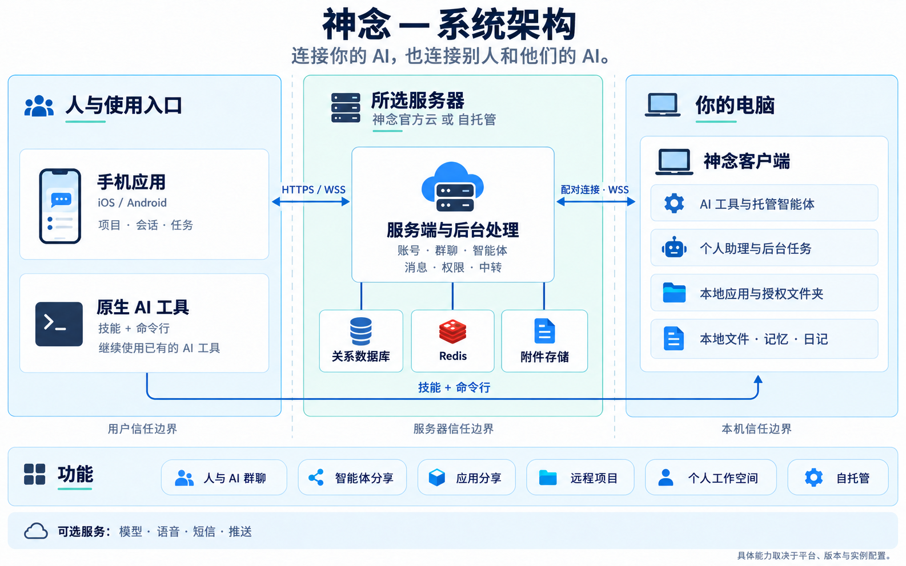
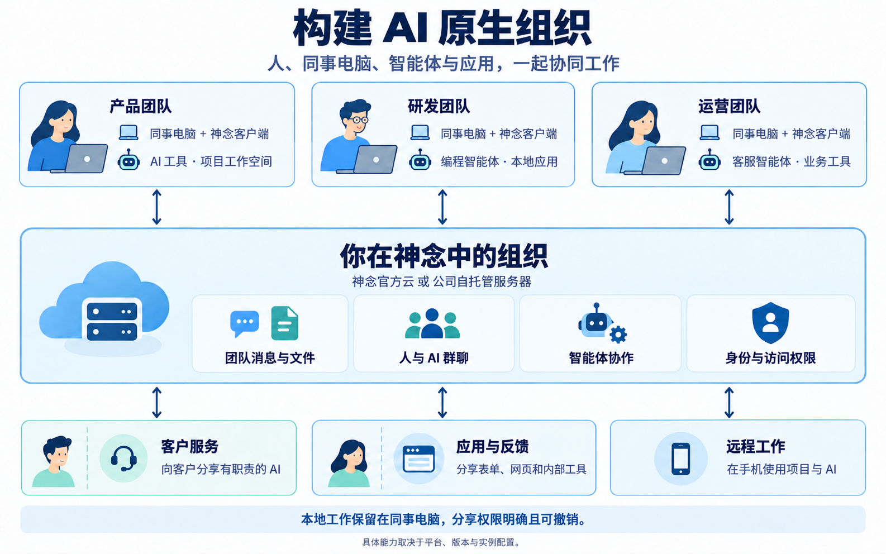

# 神念 · Shennian

**打造个人的 Personal Entity，构建企业的 AI 原生组织。**

[English](README.en.md) · [官网](https://shennian.net/) · [客户端 / Skill 安装](https://shennian.net/install.md) · [全部使用文档](https://shennian.net/docs) · [全部功能](open-source/docs/features.md)

> 私有准备仓库，暂未开放。后续是否公开由维护者另行决定。

神念帮助个人把自己的 AI、知识、应用和任务组织成 Personal Entity，也帮助企业连接同事和他们的 AI，构建 AI 原生组织。通过手机 App 或已有的原生 AI 工具安排工作、参与群聊，并按权限分享智能体与应用。可以使用神念官方云，也可以部署独立的自托管 服务端。

## 系统架构

| 组件 | 职责 |
|---|---|
| **手机应用** | 在 iOS / Android 上管理电脑、项目、会话与任务。 |
| **所选服务器** | 处理账号、群聊、消息、权限、中转与后台协调；按安装选择神念官方云或自托管。 |
| **神念客户端** | 在电脑上完成配对，连接已有 AI、托管智能体与授权应用。 |
| **本地工作空间** | 在所属电脑保存本地文件、应用业务数据、记忆、日记与原生 AI 历史。 |
| **可选服务** | 按需配置模型、语音、短信与推送；供应商处理执行所需的获授权上下文。 |

原生 AI 通过 Skill / CLI 使用 客户端；App 与 客户端 连接同一台 服务端。HTTPS / WSS 是传输加密，不是端到端加密；模型供应商会收到执行所需的获授权上下文。图示用于理解职责，精确的数据流与权限合同见[系统架构](open-source/docs/system-architecture.md)。

## 功能总览

| 功能 | 可以用来做什么 | 当前状态 |
|---|---|---|
| **已有 AI 接入** | 客户端 / CLI / Skill 连接本机 AI、工具与会话。 | 已提供 |
| **人与 AI 群聊** | 群成员、邀请、消息、附件、权限与站内未读。 | 已提供 |
| **智能体与分享** | 独立智能体身份、会话、分享链接、发现与联系人。 | 已提供 |
| **共享机器与撤权** | 为可信的人提供机器级 AI 使用权限，主人管理邀请与撤销。 | 已提供 |
| **手机远程操作** | 在手机管理电脑、项目、AI 与任务对话。 | 已提供，按平台与版本使用 |
| **个人助理 与主智能体 设置** | 选择主电脑，配置模型及默认 后台执行器 AI；内置助理调用获授权能力。 | 分阶段开发交付 |
| **Wiki / 记忆与日记** | 主电脑 Markdown 资料、有限索引读取、日记副本与编辑冲突边界。 | 开发候选 |
| **后台 后台执行器 与任务** | 授权后台执行、任务状态、事件与结果；高影响动作仍需确认。 | 依运行链路与版本提供 |
| **提醒、日历、笔记与聆听** | 个人记录、提醒与录音 / 转写能力按模块和版本开放。 | 分阶段开发交付 |
| **项目协调** | 项目队列、协调对话、后台执行器 编排与 客户端 本地网页。 | 预览版；正式版不保证支持 |
| **本机文件夹与应用** | 受权目录浏览、已登记应用与本机服务访问，不开放任意路径或端口。 | 开发候选 |
| **本地与开发应用分享** | 把自己开发或登记的应用分享给别人；限定资源与接口，支持到期和撤销。 | 服务端 已提供；发布入口按 客户端 版本使用 |
| **自托管部署与账号** | 独立 服务端 / 后台执行器、数据库、Redis、本地附件与本地账号；官方云和自托管二选一。 | 核心闭环已验证 |
| **备份恢复与升级** | 覆盖数据库、附件、配置、Redis 与本轮独立 客户端 文件。 | 单实例演练通过 |
| **模型、语音与通知** | 部署者按需配置模型、ASR / TTS、短信和系统推送；不把密钥下发给普通客户端。 | 可选配置 |
| **企业自有 OTA** | 企业构建可关闭 OTA，或固定自己的 HTTPS 更新源与验签证书；业务地址不改变代码信任源。 | 配置、签名工具与企业分发服务为开发候选 |
| **企业 SSO** | 当前使用本地账号与注册策略。 | 暂缓，不属于当前交付 |

实际能力取决于平台、安装版本和实例配置；架构图中的功能不等于所有自托管组合都已完成验证。详见[完整功能目录](open-source/docs/features.md)与[自托管验收矩阵](open-source/docs/self-hosted-acceptance.md)。

## 人与 AI 如何共同工作

同事在自己的电脑接入 AI，由同一组织的服务器管理账号、群聊与权限。人和有职责的智能体共同讨论、分工与反馈；按权限向客户提供客服智能体，或分享本地表单和业务工具。图为协作方式示意，功能状态以上表与验收矩阵为准。

## 使用神念官方云

无需先部署 服务端。

1. **安装手机 App。** 从[官网下载 iOS / Android](https://shennian.net/#downloads)，选择「神念官方云」，按引导注册或登录。
2. **在电脑安装 客户端 与 Skill。** 按[官方安装指南](https://shennian.net/install.md)操作；已有本地 AI 时，可将下方指令交给它执行。已有 客户端 应优先复用，电脑配对由你本人批准。
3. **连接自己的 AI。** 选择已经安装并登录的 AI 工具，与同一账号完成配对，检查一次真实回复。参见[AI 连接指南](https://shennian.net/docs#ai-setup)。
4. **开始使用。** 在手机打开已配对电脑或项目，发出指令并查看结果；也可以创建群聊、邀请人和智能体，或分享选定智能体。参见[快速开始](https://shennian.net/docs#quick-start)、[群聊协作](https://shennian.net/docs#collaboration)与[分享指南](https://shennian.net/docs#sharing)。

> 请先阅读 https://shennian.net/install.md，帮我在这台电脑安装或复用神念 客户端 与 Skill，引导我连接神念官方云并完成配对，检查我选用的 AI，验证一次真实回复。配对让我本人批准，不要让我在对话中粘贴密码、验证码、Token 或 API Key。

使用别人分享的 AI 或加入群聊，不要求先连接自己的 AI。远程运行自己的 AI，需要电脑 客户端 在线，并准备可用的 AI 工具；第三方账号、费用与额度遵循原服务商规则。

## 从源码构建或自托管

| 路径 | 主要步骤 | 详细文档 |
|---|---|---|
| **从源码构建** | 仓库私有期间先取得访问权限；准备 Node.js / pnpm，克隆、冻结安装并构建 App / 客户端；原生发行使用自己的签名配置。 | [源码构建](open-source/docs/getting-started.md#2-从源码构建) · [手机构建与签名](open-source/docs/mobile-app.md) |
| **自托管 服务端** | 准备服务器与受信 HTTPS，初始化独立配置，启动 Docker Compose，再让 App / 客户端 连接同一实例。 | [自托管入门](open-source/docs/getting-started.md#3-自托管自己的-server) · [Docker 部署](open-source/deploy/self-hosted/README.md) |
| **运维已有实例** | 备份数据库、附件、配置与各台 客户端；升级时遵循正式迁移与回退流程。 | [备份与升级](open-source/deploy/self-hosted/backup-and-upgrade.md) · [企业自有 OTA](open-source/docs/enterprise-ota.md) |

一个安装只使用一台活动 服务端；不要覆盖旧绑定或在官方云与自托管之间复制凭据。仓库不提供官方签名、模型 Key、客服凭据或 OTA 权限。桌面图形界面 已暂停开发；电脑侧使用 客户端 / CLI。

## 文档导航

| 入口 | 内容 |
|---|---|
| [全部在线使用文档](https://shennian.net/docs) | 安装、AI 连接、分享、群聊、手机使用与排查。 |
| [全部功能](open-source/docs/features.md) | 功能清单、状态与验证范围。 |
| [首次使用与故障排查](open-source/docs/getting-started.md) | 官方云、源码构建、首次配对与部署检查。 |
| [系统架构](open-source/docs/system-architecture.md) | 组件、数据流、权限与存储边界。 |
| [应用与智能体指南](open-source/docs/application-examples.md) | 本地应用与客服智能体；附[可运行意见表示例](open-source/docs/examples/feedback-form/README.md)。 |
| [安全说明](open-source/SECURITY.md) | 安全问题反馈与敏感信息处理。 |

## 源码导航

| 目录 | 内容 |
|---|---|
| `packages/app/` | 共用手机应用。 |
| `open-source/packages/` | 服务端、后台处理、电脑客户端 / 命令行、通信层与开发套件。 |
| `open-source/docs/` | 功能、架构、使用说明与可运行示例。 |
| `open-source/deploy/` | Docker 部署、数据库迁移、备份与升级工具。 |
| `plugins/shennian/` | 技能与接入资料。 |

## 许可与联系

[Shennian Community License 1.0](LICENSE) 允许个人自用、同一组织最多 **20 个已启用自然人账号**在许可条件内内部使用，并保留品牌和版权声明。这是有使用条件的源码可用许可，不是 MIT / Apache 或无限制商用许可。第三方组件保留各自许可；自建应用、内容与业务数据保留各自权利。

[许可说明](open-source/LICENSE-STATUS.md) · [第三方声明](open-source/docs/third-party/README.md) · [联系团队](https://shennian.net/#contact)
