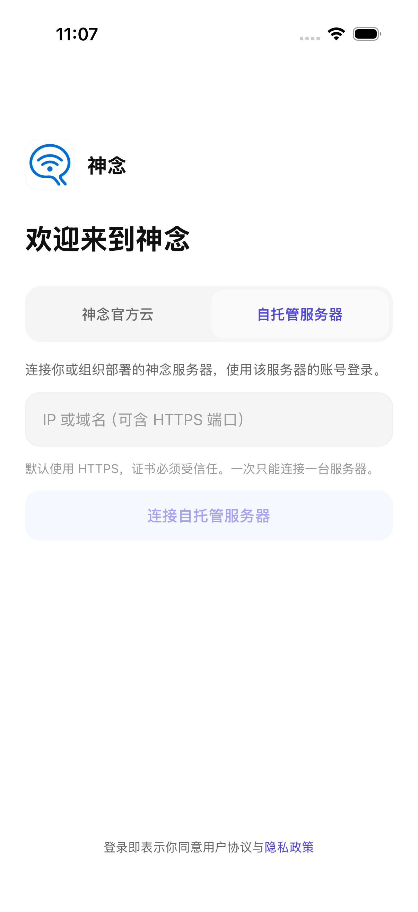

# 功能与自托管范围

<!-- Generated by scripts/render-public-site.mjs from scripts/site/self-hosted.mjs. -->

核对日期：2026-10-27。官网与本页使用同一功能清单。共用 App 位于 `packages/app`，公共 Core 位于 `open-source/packages`，从同一套实现构建。具体部署、平台和功能的验收范围分别记录。

登录页采用「神念官方云 / 自托管服务器」双 Tab。自托管先填 IP / 域名并连接，通过受信 HTTPS 与实例发现后，再登录或按策略注册。电脑 Client 必须连接同一实例并完成配对；同一安装只有一台活动 Server，已有绑定不支持直接覆盖换服。请按实际安装版本和实例配置使用；平台发布状态以用户指南为准。

## 功能清单

| 功能 | 作用 | 当前状态 | 自托管验证范围 |
|---|---|---|---|
| 已有 AI 接入 | Client / CLI / Skill 连接本机 AI、工具与会话。 | 已提供 | 已验证原生 Pi；其他工具需逐一检查。 |
| 人与 AI 群聊 | 群成员、邀请、消息、附件、权限与站内未读。 | 已提供 | 两用户 API 与权限、附件链路已验证。 |
| 智能体与分享 | 独立智能体身份、会话、分享链接、发现与联系人。 | 已提供 | 托管 Agent 对话与历史已验证；分享、发现、联系人仍待专项验收。 |
| 共享机器与撤权 | 为可信的人提供机器级 AI 使用权限，主人管理邀请与撤销。 | 已提供 | 未完成自托管专项验收；整机信任不等于文件沙箱。 |
| 手机远程操作 | 在手机管理电脑、项目、AI 与任务对话。 | 已提供，按平台与版本使用 | iOS 开发构建填写地址、注册登录、配对和真实回复通过；Android / 真机待验。 |
| Personal Agent 与主 Agent 设置 | 选择主电脑，配置模型及默认 Worker AI；内置助理调用获授权能力。 | 分阶段开发交付 | 内置个人助理尚未完成自托管验收；普通 Pi 回复不能替代。 |
| Wiki / 记忆与日记 | 主电脑 Markdown 资料、有限索引读取、日记副本与编辑冲突边界。 | 开发候选 | 待专项验收；不宣称完整云 Wiki 或向量知识库。 |
| 后台 Worker 与任务 | 授权后台执行、任务状态、事件与结果；高影响动作仍需确认。 | 依运行链路与版本提供 | 基础持久队列恢复已验证；Personal Agent Worker 待专项验收。 |
| 提醒、日历、笔记与聆听 | 个人记录、提醒与录音 / 转写能力按模块和版本开放。 | 分阶段开发交付 | 未完成本轮专项验收；语音供应商未配置。 |
| 项目协调 | 项目队列、协调对话、Worker 编排与 Client 本地网页。 | 预览版；正式版不保证支持 | 官方云 iOS / Client 受控链路已验证；自托管未专项验收。 |
| 本机文件夹与应用 | 受权目录浏览、已登记应用与本机服务访问，不开放任意路径或端口。 | 开发候选 | 待专项验收。 |
| 本地与开发应用分享 | 把自己开发或登记的应用分享给别人；限定资源与接口，支持到期和撤销。 | Server 已提供；发布入口按 Client 版本使用 | 应用和 Client 需保持在线；当前通过开发 CLI 发布，手机尚无分享菜单。 |
| 自托管部署与账号 | 独立 Server / Worker、数据库、Redis、本地附件与本地账号；官方云和自托管二选一。 | 核心闭环已验证 | 共用 App 源码、Docker 独立构建、正式迁移、单实例绑定和模型回复已验证。 |
| 备份恢复与升级 | 覆盖数据库、附件、配置、Redis 与本轮独立 Client 文件。 | 单实例演练通过 | 加密备份、隔离恢复和一对镜像升级回退通过；不是任意跨版本兼容。 |
| 模型、语音与通知 | 部署者按需配置模型、ASR / TTS、短信和系统推送；不把密钥下发给普通客户端。 | 可选配置 | 仅配置一家 DashScope qwen-plus，语音 / 短信 / 推送未启用，缺配置提示仍待逐页完善。 |
| 企业自有 OTA | 企业构建可关闭 OTA，或固定自己的 HTTPS 更新源与验签证书；业务地址不改变代码信任源。 | 配置、签名工具与企业分发服务为开发候选 | 配置隔离、签名 / 篡改、渠道 / runtime / 平台与发布工具已测；企业原生壳真实升级 / 回退尚未验收。 |
| 企业 SSO | 当前使用本地账号与注册策略。 | 暂缓，不属于当前交付 | 未实现，不作为当前验收门禁。 |

## 架构与数据边界

图中只包含开源框架，不代表所有模块已验收。每台 Client 的工作空间、记忆、日记和密钥需独立备份，Server 备份不能代替。HTTPS / WSS 不是端到端加密。Desktop 暂停维护与分发；SSO 暂缓。

社区免费上限、商业授权与联系渠道见[社区与商业授权](commercial-licensing.md)。

详细见[系统架构](system-architecture.md)、[验收矩阵](self-hosted-acceptance.md)、[企业自有 OTA 配置](enterprise-ota.md)及[部署与备份升级](../deploy/self-hosted/README.md)。
