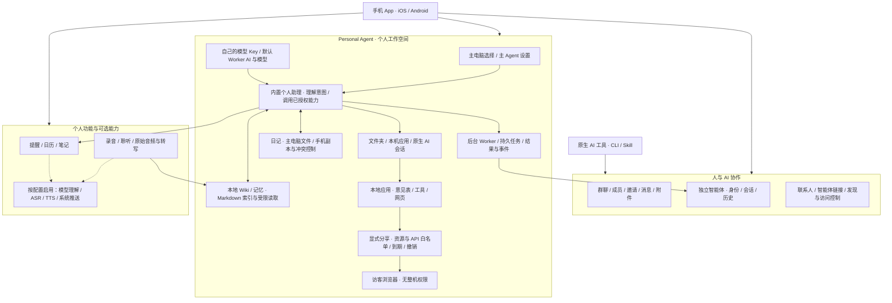
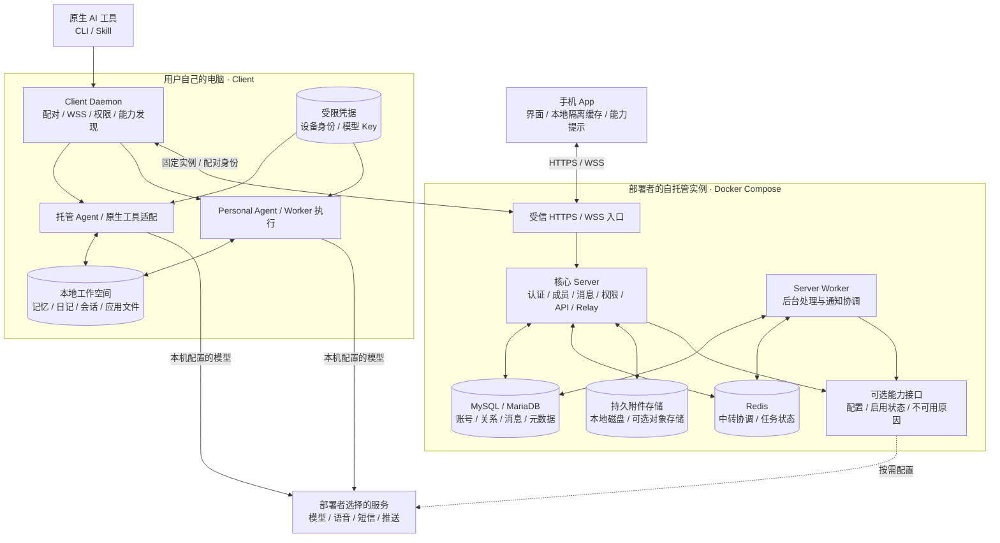

# 神念开源功能与系统架构

> 核对日期：2026-10-27。这是开源框架的功能地图与运行结构，不是“全部功能已完成自托管验收”的承诺。当前验收范围见[自托管验收矩阵](self-hosted-acceptance.md)。手机是主要入口；Client / CLI 是电脑上的执行器，不是桌面界面产品。

这张生成式功能架构图用于展示模块全景；下方 Mermaid 与文字定义精确的运行与权限关系。应用分享与客服实践见[应用案例](application-examples.md)。

## 1. 功能全景：连接人、自己的 AI 与别人的 AI

### 各块做什么、什么不是默认承诺

| 功能 | 框架职责与边界 |
|---|---|
| 账号、设备与协作 | 本实例登录注册、设备配对、成员权限、群消息、附件及会话同步；注册可关闭、邀请或开放，不因可登录就允许公开注册。 |
| 独立智能体 | 神念管理的 Agent 有独立成员身份；外部 AI 通过 CLI / Skill 操作群聊仍以真人身份发送，不能混淆。 |
| Personal Agent | 内置个人助理运行在所选主电脑；主电脑必须属于本人、在线且具备所需能力。切主电脑不自动迁移旧文件，也不偷偷退到另一台电脑执行。 |
| 主 Agent 设置 | 主电脑、模型配置和默认 Worker AI / 模型分别管理；选项受本机实际发现与能力约束。模型 Key 保存在执行端私有配置，不回传手机明文。 |
| Worker 与任务 | 将获授权的复杂工作交给后台执行器，追踪任务、事件和结果。后台任务不等于群成员，也不能绕过高影响动作的人类确认。 |
| Wiki / 记忆 | 主电脑上的 Markdown 工作空间和索引，不是默认上传全文的云 Wiki 或完整向量知识库。主 Agent 注入有限索引、明确授权摘要和必要任务上下文，不扫描整库；手机按本人权限受限读取。 |
| 日记 | 主电脑文件为权威，手机可有隔离副本；编辑须满足 Client 能力、版本与冲突检查。日记编辑权限不等于可改写记忆目录。 |
| 提醒 / 日历 / 笔记 | 个人功能具有各自的数据与权限边界；提醒、日历的账号数据不要求电脑始终在线，后台 Agent 执行任务与日历提醒不是同一种任务。 |
| 录音 / 聆听 | 采集、持久分段和转写链路与可选 AI 理解分开；处理目标绑定指定电脑与版本，生成行动建议不代表自动获得执行授权。 |
| 文件夹 / 本机应用 | 访问本人电脑获授权目录，或通过 Client 运行已登记应用；不暴露任意端口、任意路径、机器 Token，也不默认公开分享。 |
| 联系人 / Agent 链接 | 沿用本实例的身份、可见性与访问控制，不把两个独立实例自动合并成公共社交网络。 |

**区分两种 Agent：**已验收的 QA host 模型回复使用原生 Pi 工具中的托管 Agent；内置 Personal Agent 是另一条运行链，不能用前者的测试替代后者的验收。上表是功能职责说明，不代表所有页面、供应商、平台和组合都已测试。

## 2. 运行架构：一个客户端，一台活动 Server

- 同一安装只连接一台活动 Server，不混排个人云与公司实例的账号、消息、Token 或本地历史。已有绑定不能用临时地址覆盖直接换服；目前安全换服迁移尚未交付。
- 每个实例独立维护数据库、Redis、对象、实例身份和密钥。无短信、语音、系统推送或服务端模型 Key 也应能提供最小协作链路；不能静默回退到别人的实例或密钥。
- 图中的适配层表示职责，不表示所有历史调用点已统一为同一插件接口。扩展契约见 [Server 扩展](server-extensions.md)。
- Client 的文件访问与原生 AI 权限由用户管理；单实例绑定不是操作系统沙箱。HTTPS / WSS 是传输加密，不是端到端加密；模型供应商会收到执行所需的获授权上下文。

## 3. 数据放在哪里，备份覆盖到哪里

| 位置 | 主要数据 | 恢复注意事项 |
|---|---|---|
| Server 数据库 | 账号、成员与会话关系、共享消息、配置和元数据 | 正式 migration 与数据一起备份；升级只追加迁移，不重写已应用 SQL。 |
| 附件存储 | 上传对象与附件内容 | 数据库备份不能代替附件备份；私有签名 URL 不等于可公开目录。 |
| Redis | 中转、队列和协调状态 | 是否可重建取决于具体状态；备份与恢复必须记录暂停写入和一致性边界。 |
| 每台 Client | 原生历史、个人记忆 / 日记、工作空间、应用与设备身份 | Server 备份不包含这些文件；每台主电脑单独纳入备份。恢复副本不能与原设备同时以同一身份上线。 |
| 手机 | 按实例 / 账号隔离的缓存与草稿 | 不作为唯一恢复来源；不能跨实例搬运旧 Token 或误合并个人资料。 |
| 密钥与部署配置 | 数据库凭据、签名密钥、证书、模型 Key | 只在加密且访问受限的备份中保管，不放进源码、镜像、截图和公开日志。 |

## 4. 部署与功能开关

首版采用容器配置与只读 secret 文件，不要求独立密钥管理后台，也不要求安装 AI 才能配置。核心必填项缺失应拒绝启动并只报告名称。可选能力未配置时核心继续工作，入口应说明“此实例未配置，请联系管理员”；关闭、缺配置和供应商临时故障需区别呈现，不能全部叫网络错误。普通客户端只取得能力状态，不取得密钥。

目前部分开关已有实现，**统一缺失配置提示仍需逐页补验**。SSO 不属于当前交付范围，当前使用本地账号和注册策略。

## 5. 代码、文档与测试同源

完整仓库保留 `packages/app` 和 `open-source` 的相对布局：App 是共用的唯一实现，Core 的 Server / Worker / Client / Wire / SDK 位于 `open-source/packages`；功能、接口规范、部署说明与测试一起分发。不需要官方签名、私有模块或内部设计资料即可从源码构建。根 README 提供完整构建入口；本目录也可独立进行 Core 构建和测试。

安装与迁移见[自托管部署说明](../deploy/self-hosted/README.md)，已测、未测和限制见[验收矩阵](self-hosted-acceptance.md)。

## 6. 本地应用分享的数据流

应用在自己的电脑运行 → Client 登记固定端口与入口 → 主人声明 GET 资源与 POST 接口 → Server 创建可撤销、有期限的分享 → 访客通过隔离页面与受控桥接访问 → Client 仅转发允许的本机请求 → 应用自行校验并持久化业务数据。不是任意端口隧道，也不提供完整云应用托管。参考[意见表源码](examples/feedback-form/README.md)。

Local apps run on their owner's computer. Client registers a fixed port/entry; the owner explicitly allows GET resources and POST APIs. Server provides expiring, revocable sharing through an isolated page and constrained bridge. Client forwards only allowed requests; the app validates and persists its own business data. This is not an arbitrary-port tunnel or full cloud application hosting.
